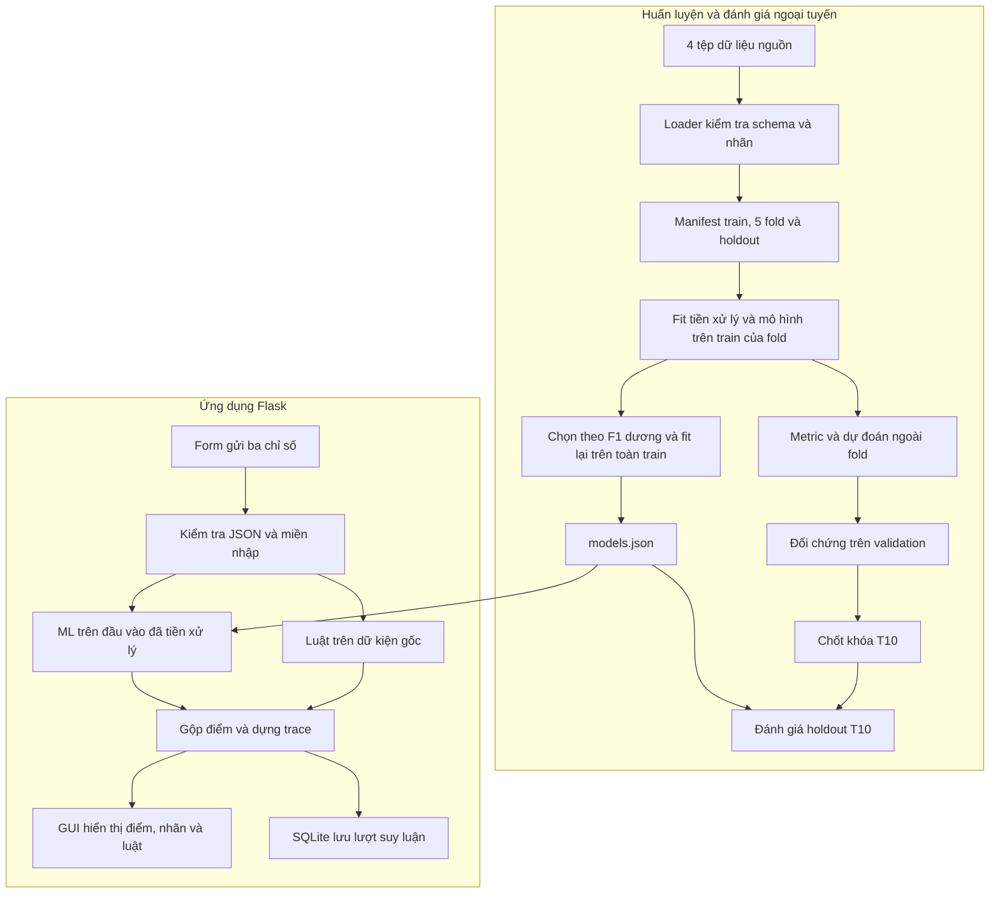
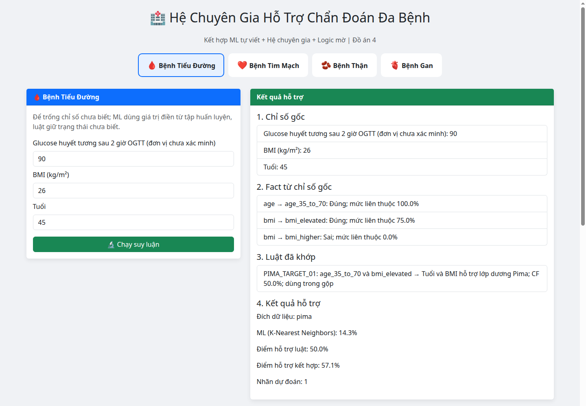

# Medical Expert System · Báo cáo dự án từ A đến Z

**Đồ án hệ chuyên gia kết hợp học máy · 18/11/2026**

**Phiên bản mô tả** `510b56e` trên nhánh `duck`.

Ứng dụng nhận ba chỉ số của một ca, tính điểm hỗ trợ lớp dương bằng mô hình học máy và cho biết những luật chuyên gia nào khớp với dữ kiện gốc. Với Cleveland và Pima, luật cùng đích có thể nâng điểm và đổi nhãn dự đoán. Với ILPD và CKD, hệ thống hiện dùng điểm ML. Đây là đồ án thực nghiệm trên các nhãn có sẵn của bộ dữ liệu. Điểm trên GUI chưa được hiệu chỉnh thành xác suất mắc bệnh của một cá nhân.

| Nếu bạn muốn hiểu… | Đọc phần |
|---|---|
| Dự án bắt đầu ở đâu và đã thay đổi gì | [1. Quá trình phát triển](#1-quá-trình-phát-triển) |
| Dữ liệu đi đâu, vì sao mô hình được chọn | [2. Kiến trúc](#2-kiến-trúc), [3. Dữ liệu](#3-dữ-liệu-và-cách-chia-tập), [4. Huấn luyện](#4-huấn-luyện-và-chọn-mô-hình) |
| Hệ chuyên gia đóng góp gì, một ca chạy thế nào | [5. Suy luận](#5-suy-luận-và-gộp-điểm), [6. Một ca từ đầu đến cuối](#6-một-ca-từ-đầu-đến-cuối) |
| Muốn mở ứng dụng, kiểm tra lịch sử hoặc tự chạy lại | [7. Vận hành](#7-vận-hành-và-kiểm-tra) |
| Kết quả đáng nói nhất và những giới hạn | [8. Kết quả](#8-kết-quả-và-cách-diễn-giải), [9. Giới hạn](#9-giới-hạn-và-hướng-tự-cải-thiện) |

## 1. Quá trình phát triển

Phiên bản đầu đã có Flask, giao diện chọn bệnh, thuật toán NumPy, logic mờ, luật IF–THEN và SQLite. Commit gốc `94d2643` ngày 15/11 sinh 300 bản ghi giả cho mỗi nhóm, huấn luyện lúc Flask khởi động, dùng ensemble để suy luận và chạy `DROP TABLE IF EXISTS history` khi khởi tạo. Các điểm lúc đó phục vụ minh họa nguyên mẫu. Đồ án sau đó đặt hai mục tiêu có thể kiểm tra được. Mục tiêu thứ nhất là so sánh mô hình trên bốn bộ dữ liệu thật theo cùng giao thức. Mục tiêu thứ hai là đo tác động của luật trên Cleveland và Pima, đồng thời cho người xem lần lại từng bước suy luận trên một ca. [Đặc tả](../SPEC.md) · [Mốc cuối Tuần 1](BAO_CAO_TIEN_DO_TUAN_1.md)

| Mốc | Vấn đề và công việc đã làm | Bằng chứng bàn giao |
|---|---|---|
| **T01–T02 · Nền ứng dụng** | Bỏ lệnh xóa bảng khi khởi động. Thêm đường dẫn SQLite qua biến môi trường. Kiểm tra nhóm bệnh, khóa JSON, kiểu, miền nhập và lỗi theo từng ô trước khi lưu. | Test giữ bản ghi qua hai lần khởi tạo, test yêu cầu lỗi không sinh bản ghi. Commit `6c8f5dc`, `1f35d98`. |
| **T03–T05 · Dữ liệu thật** | Xác minh Cleveland và Pima, chuẩn hóa schema, lưu manifest chia tập. Đưa ILPD và CKD vào cùng pipeline. | Hồ sơ nguồn, metadata và manifest có SHA-256. Commit `862a7f3`, `44ac1b5`, `4b3c241`. |
| **T06 · Huấn luyện** | Tách huấn luyện ngoại tuyến khỏi Flask. Chạy bốn mô hình tự viết, ensemble và baseline. Mỗi bộ có mô hình được chọn theo F1 kiểm chứng chéo. | Run `t06-cv-seed42` chứa mô hình đã fit, dự đoán và metric. Commit `46e7836`. |
| **T07–T09 · Luật và đối chứng** | Rà soát ngữ nghĩa luật, đánh dấu luật cùng đích, đưa điểm ML vào phép gộp một lần và xây trace. So bốn cấu hình trên dự đoán ngoài fold. | Bảng nguồn luật, test phép gộp, run `t09-validation-seed42`. Commit `7ee3b5a`, `cb396f3`, `5df8e64`. |
| **T10 · Đánh giá cuối** | Khóa nguồn, mô hình, split, luật, ngưỡng và mã phương pháp trước khi chạy holdout. | Commit khóa `0f79c31` đứng trước commit kết quả `3427051`. Run `t10-test-seed42` có 380 dòng metric và 3.314 dòng dự đoán. |
| **T11–T13 · Giải thích và demo** | GUI đọc trace. Phân tích ca sai, ca luật và ML bất đồng. Chuẩn bị sáu ca tự tạo bao gồm thiếu dữ kiện, ngay ngưỡng mờ, nhiều luật và ngoài miền. | [Phân tích lỗi](../tasks/T12_ERROR_ANALYSIS.md) · [Ca demo và ảnh](../tasks/T13_DEMO.md). Commit `51c62a4`, `aa35a37`, `e9210b1`. |
| **T14–T15 · Chốt phạm vi và bàn giao** | T14 là thử nghiệm fuzzy liên tục, được quyết định bỏ qua trước khóa T10. T15 kiểm tra dựng từ bản Git sạch và chạy đủ bốn nhóm. | 46/46 test ở mốc T15. Run được tái lập và đối chiếu với khóa. Commit `539b442`. |
| **Sau bàn giao · Review và GUI** | Đặt điểm ML, luật và kết hợp cạnh nhau. Thêm giải thích trường thiếu, ngưỡng chuẩn hóa của cây và ý nghĩa điểm lịch sử. Chuyển CSS/JS sang tài nguyên cục bộ. | 47/47 test, sáu ca Chrome, bốn form và màn hình rộng 390 px. Commit `0f85450`, `510b56e`. |

Các nhãn “Tuần 1–4” trong backlog là nhóm công việc theo kế hoạch. Tiến độ thực tế đối chiếu theo commit và bằng chứng nghiệm thu. [TASKS](../TASKS.md) · [STATUS](../STATUS.md)

## 2. Kiến trúc

Dự án có hai luồng. Luồng **huấn luyện ngoại tuyến** đọc tệp nguồn, fit mô hình và ghi run. Luồng **suy luận** đọc mô hình đã fit khi Flask khởi động, rồi xử lý từng yêu cầu. SQLite lưu lượt sử dụng ứng dụng. Các tệp CSV trong run lưu kết quả thực nghiệm. Hai nơi lưu phục vụ hai mục đích độc lập.



| Khi muốn tìm… | Mở tệp |
|---|---|
| Các đặc trưng, tên hiển thị và miền nhập của form | [medical_expert/web/diseases.py](../../medical_expert/web/diseases.py) |
| Nạp tệp nguồn, chuẩn hóa nhãn, sinh ID | [medical_expert/data/loaders.py](../../medical_expert/data/loaders.py) · [medical_expert/data/ilpd.py](../../medical_expert/data/ilpd.py) · [medical_expert/data/ckd.py](../../medical_expert/data/ckd.py) |
| Chia dữ liệu, điền thiếu và chuẩn hóa | [medical_expert/data/pipeline.py](../../medical_expert/data/pipeline.py) |
| Công thức mô hình NumPy, cấu hình và cách khôi phục artifact | [medical_expert/ml/algorithms.py](../../medical_expert/ml/algorithms.py) · [medical_expert/ml/runtime.py](../../medical_expert/ml/runtime.py) |
| Lệnh huấn luyện, đối chứng và đánh giá | [train.py](../../scripts/train.py) · [validate_ablation.py](../../scripts/validate_ablation.py) · [evaluate.py](../../scripts/evaluate.py) |
| Fact, luật đích, phép gộp và trace | [medical_expert/expert/rules.py](../../medical_expert/expert/rules.py) · [medical_expert/expert/fusion.py](../../medical_expert/expert/fusion.py) |
| API, lịch sử và giao diện | [medical_expert/web/app.py](../../medical_expert/web/app.py) · [index.html](../../medical_expert/web/templates/index.html) · [workspace.js](../../medical_expert/web/static/workspace.js) · [workspace.css](../../medical_expert/web/static/workspace.css) |

Để lần theo suy luận hiện tại, bắt đầu ở `diagnose()`, rồi đọc `RuntimeModel.score()`, `evaluate_rules()` và `make_trace()`. Bộ `legacy/knowledge_base.json` và `legacy/inference_engine.py` thuộc nguyên mẫu. Luật được API hiện tại gọi nằm trong `medical_expert/expert/rules.py`. [Điểm vào Flask](../../medical_expert/web/app.py) · [Luật](../../medical_expert/expert/rules.py)

## 3. Dữ liệu và cách chia tập

### Đọc đúng từng bộ nguồn

| Bộ và nguồn | Đặc trưng dùng, theo thứ tự mô hình | Mã nhãn dương | Tổng mẫu (âm/dương) | Train (âm/dương) | Holdout (âm/dương) |
|---|---|---|---:|---:|---:|
| Cleveland · UCI #45 | Tuổi, huyết áp lúc nghỉ `trestbps`, cholesterol `chol` | `num` từ 1 đến 4 | 303 (164/139) | 242 (131/111) | 61 (33/28) |
| Pima · OpenML #37 v1 | Glucose OGTT hai giờ `plas`, BMI `mass`, tuổi | `tested_positive` | 768 (500/268) | 614 (400/214) | 154 (100/54) |
| ILPD · UCI #225 | Bilirubin toàn phần `TB`, albumin `ALB`, tuổi | `Selector=1` | 570 (164/406) | 456 (131/325) | 114 (33/81) |
| CKD · UCI #336 | Creatinine huyết thanh `sc`, huyết áp `bp`, tuổi | `ckd` | 400 (150/250) | 320 (120/200) | 80 (30/50) |

- **Cleveland.** Dùng tệp 14 cột `processed.cleveland.data`. Ba trường đã chọn đầy đủ. Missing ở `ca` và `thal` nằm ngoài ba trường này. [Hồ sơ Cleveland và Pima](../tasks/T03_DATA_SOURCES.md)
- **Pima.** Năm giá trị glucose bằng 0 và 11 giá trị BMI bằng 0 được quy về thiếu. Tài liệu nguồn xác nhận phép đo glucose hai giờ OGTT. Đơn vị riêng của cột `plas` và quyền tái phân phối tệp gốc vẫn chưa xác minh. Quần thể nghiên cứu gồm phụ nữ gốc Pima từ 21 tuổi trở lên. [Hồ sơ Cleveland và Pima](../tasks/T03_DATA_SOURCES.md)
- **ILPD.** Tệp gốc có 583 dòng. Loại 13 dòng trùng toàn bộ còn 570. Ba trường đã chọn đầy đủ. Đơn vị bilirubin và albumin chưa được xác minh từ tài liệu nguồn. [Hồ sơ ILPD và CKD](../tasks/T05_DATA_SOURCES.md)
- **CKD.** Thiếu 17 giá trị creatinine, 12 huyết áp và 9 tuổi. Creatinine tính bằng mg/dL. Huyết áp ghi mmHg, hồ sơ nguồn chưa xác định tâm thu hay tâm trương. [Hồ sơ ILPD và CKD](../tasks/T05_DATA_SOURCES.md)

Loader đối chiếu cấu trúc và phiên bản tệp, giữ dòng đầu khi trùng trên **toàn bộ cột nguồn đã chuẩn hóa, gồm nhãn**, rồi xuất ba đặc trưng và nhãn nhị phân. ID dựa trên vị trí dòng trong cùng tệp. Hai dòng có cùng ba đặc trưng vẫn có thể là hai bản ghi riêng. Các nguồn thiếu mã bệnh nhân nên giao thức phân tầng theo **nhãn** và giữ ID ổn định theo bản tệp. [Đặc tả dữ liệu](../SPEC.md)

### Từ một tệp nguồn đến 5 fold

1. **Giữ khoảng 20% làm holdout.** Thuật toán phân bổ theo tỷ lệ nhãn, xáo ID trong từng lớp với seed `42` và ghi lại ID. Ví dụ Cleveland có 61/303 ca trong holdout.
2. **Chia phần train thành 5 fold.** Mỗi lượt dùng bốn fold để fit và fold còn lại để validation. Từng ID train được dự đoán đúng một lần bởi mô hình chưa fit trên ID đó. Đây là dự đoán ngoài fold (*out-of-fold*, OOF).
3. **Fit tiền xử lý trong từng lượt.** Tính trung vị trên phần train của fold, điền giá trị thiếu rồi tính trung bình và độ lệch chuẩn trên dữ liệu train đã điền. Với mỗi cột, đổi `x` thành `(x − mean_train) / scale_train`. Cột hằng dùng scale 1. Cột thiếu toàn bộ trong train báo lỗi.
4. **Dùng lại thống kê đã học.** Validation nhận median, mean và scale từ train của fold tương ứng. Khi fit lại mô hình cuối, ba thống kê được học từ toàn bộ train và dùng cho holdout lẫn ứng dụng. Nhánh luật vẫn nhận chỉ số gốc, với giá trị thiếu là chưa biết.

Nếu tính median hoặc scale trên cả tập rồi mới chia, dữ liệu dành cho đánh giá đã tác động đến đầu vào của quá trình huấn luyện. Manifest và test T04 kiểm tra rằng thay đổi riêng dữ liệu validation hoặc holdout trong fixture không làm thống kê fit trên train thay đổi. [Quy trình T04](../tasks/T04_DATA_PIPELINE.md) · [Manifest Cleveland/Pima](../../manifests/t04_split_manifest.json) · [Manifest ILPD/CKD](../../manifests/t05_split_manifest.json)

## 4. Huấn luyện và chọn mô hình

Các mô hình cùng nhận ba đặc trưng của từng bộ, dùng chung manifest và được tính điểm tại ngưỡng phân lớp 0,5. Chương trình chạy một bộ cấu hình cố định cho mỗi thuật toán.

| Phương án | Học và trả điểm thế nào | Cấu hình T06 |
|---|---|---|
| Logistic Regression | Học trọng số và bias bằng gradient descent trên binary cross-entropy. Đưa tổ hợp tuyến tính qua sigmoid. | Learning rate 0,1, 300 vòng. |
| K-Nearest Neighbors | Lưu ma trận train đã biến đổi và nhãn. Tìm các điểm gần nhất theo khoảng cách Euclid, trả tỷ lệ nhãn 1. | `k=7`. |
| Gaussian Naive Bayes | Học prior, trung bình và phương sai theo từng lớp. Tính log-density Gaussian của từng đặc trưng, cộng với log-prior rồi chuẩn hóa điểm giữa hai lớp. | Giả định độc lập có điều kiện, cộng `1e-9` vào phương sai. |
| Decision Tree | Tìm đặc trưng và ngưỡng tách nhị phân làm giảm entropy nhiều nhất. Khi đến lá, trả tỷ lệ nhãn 1 tại lá. | Sâu tối đa 4, `min_samples_split=5`. |
| Ensemble Voting | Fit bốn mô hình trên và lấy trung bình bốn điểm lớp dương. | Trung bình đều, còn gọi là soft voting. |
| Baseline lớp phổ biến | Luôn dự đoán lớp xuất hiện nhiều nhất trong train của lượt fit. | Nếu hòa chọn 0. Baseline dùng làm mốc. |

Trong mỗi bộ, hệ thống chọn theo **trung bình F1 lớp dương qua 5 fold** trong năm phương án ứng viên. Nếu hòa điểm, thứ tự ưu tiên là Logistic Regression, KNN, Gaussian NB, Decision Tree, Ensemble. Sau CV, chương trình fit lại các phương án trên toàn bộ train và ghi tên mô hình đã chọn để Flask sử dụng. [Huấn luyện T06](../tasks/T06_TRAINING.md) · [Cấu hình NumPy](../../medical_expert/ml/runtime.py)

| Phương án · F1 CV trung bình | Cleveland | Pima | ILPD | CKD |
|---|---:|---:|---:|---:|
| Logistic Regression | 0,5413 | 0,6289 | **0,8199** | 0,7865 |
| KNN | 0,5228 | **0,6655** | 0,7933 | 0,8433 |
| Gaussian NB | **0,5868** | 0,6328 | 0,5134 | 0,8697 |
| Decision Tree | 0,5752 | 0,6552 | 0,8000 | **0,9352** |
| Ensemble | 0,5392 | 0,6531 | 0,7851 | 0,9051 |
| Baseline | 0,0000 | 0,0000 | 0,8323 | 0,7692 |

In đậm là mô hình được chọn trong nhóm ứng viên. Độ lệch chuẩn F1 tương ứng với Cleveland, Pima, ILPD và CKD lần lượt là 0,0263, 0,0644, 0,0268 và 0,0189. Baseline ILPD luôn đoán dương do lớp 1 chiếm đa số. F1 dương của baseline cao hơn cả năm ứng viên trên CV. Đây là lý do cần xem cả hai lớp ở phần kết quả. [Bảng CV đã xuất](../../results/t06-cv-seed42/metrics.csv) · [Tóm tắt T06](../tasks/T06_TRAINING.md)

| Tệp trong một run T06 | Dùng để làm gì |
|---|---|
| `metadata.json` | Xem seed, nguồn, mô hình chọn, tham số và metric nào thiếu định nghĩa. |
| `split_manifest.json` | Đối chiếu ID train, holdout và fold với manifest đã lưu trong repo. |
| `models.json` | Khôi phục tham số tiền xử lý, trạng thái mô hình, thống kê CV và chuỗi cây. Trạng thái KNN chứa ma trận train đã biến đổi và nhãn, vì vậy artifact cần quản lý theo điều kiện dữ liệu nguồn. |
| `metrics.csv` | Lấy metric từng fold và tổng hợp CV. Confusion matrix tổng hợp dùng tổng số đếm qua fold. |
| `predictions.csv` | Lần theo từng ID, nhãn thật, nhãn dự đoán và điểm của lượt ngoài fold. T09 đọc tệp này. |

## 5. Suy luận và gộp điểm

### Từ chỉ số gốc sang luật khớp

**Fact** là một mệnh đề có thể đúng, sai hoặc chưa biết. Chẳng hạn, với cholesterol của Cleveland, hàm liên thuộc tăng tuyến tính từ 0 tại 180 mg/dL đến 1 tại 220 mg/dL. Fact được tính là đúng khi mức liên thuộc **lớn hơn** 0,5. Chính xác 200 mg/dL cho mức 0,5 và fact sai. Nếu ô trống, fact chưa biết. Điều kiện tuổi dùng so sánh rời rạc. Một luật khớp khi mọi tiền đề của nó đều đúng. [Hàm liên thuộc](../../medical_expert/expert/fuzzy.py) · [Luật trong mã](../../medical_expert/expert/rules.py)

| Luật | Điều kiện tương đương sau khi xác định fact | CF | Vai trò |
|---|---|---:|---|
| `CLEV_TARGET_01` | Tuổi ≥55 và cholesterol >200 mg/dL | 0,55 | Góp điểm cho nhãn dương Cleveland. |
| `CLEV_SECONDARY_01` | Cholesterol >200 mg/dL | 0,40 | Xuất hiện trong trace như dấu hiệu phụ. |
| `PIMA_TARGET_01` | Tuổi 35–70 và BMI >25 kg/m² | 0,50 | Góp điểm cho nhãn dương Pima. |
| `PIMA_TARGET_02` | Tuổi 35–70 và BMI >30 kg/m² | 0,55 | Góp điểm cho nhãn dương Pima. |

CF là hệ số hỗ trợ do đồ án đặt. Hai luật Pima chia sẻ tuổi và có các mốc BMI lồng nhau. Pima dùng glucose trong ML, còn luật dùng tuổi và BMI do đơn vị cột glucose chưa xác nhận. ILPD thiếu xác minh đơn vị cho hai chỉ số. CKD thiếu thông tin diễn tiến theo thời gian và loại huyết áp. Hai nhóm sau hiện chỉ có điểm ML. Mục “Quy tắc trích từ cây quyết định” trên GUI là mô tả các đường từ nút gốc tới lá của mô hình cây. Menu này dùng ngưỡng trên dữ liệu đã chuẩn hóa và độc lập với bốn luật ở bảng trên. [Nguồn và ánh xạ luật](../tasks/T07_RULES.md) · [Cách xuất cây](../../medical_expert/ml/algorithms.py)

### Bốn cấu hình được so sánh

Gọi `p` là điểm ML, `cᵢ` là CF của luật cùng đích thứ `i` đã khớp và `R` là điểm của hệ luật.

| Cấu hình | Cách tính |
|---|---|
| ML | `p` |
| Chỉ luật | `R = 1 − ∏(1 − cᵢ)` |
| Gộp mới · dùng trong GUI | `R + p × (1 − R)` |
| Gộp cũ · dùng để đối chứng | Gộp `p` vào từng luật thành `qᵢ = cᵢ + p × (1 − cᵢ)`, rồi tính `1 − ∏(1 − qᵢ)`. |

Mỗi điểm có giá trị từ 0 đến 1. Nhãn là 1 khi điểm **lớn hơn hoặc bằng** 0,5. Khi thiếu luật cùng đích khớp, chỉ luật bỏ ngỏ, còn cả hai cấu hình gộp trả `p`. Vì vậy độ bao phủ của luật là tỷ lệ mẫu có luật đích khớp. Kết quả chỉ luật được so với ML và gộp trên cùng tập con được bao phủ. Kết quả toàn tập vẫn so được ML và hai cách gộp. [Mã phép gộp](../../medical_expert/expert/fusion.py) · [Thiết kế đối chứng](../tasks/T09_VALIDATION.md)

Tại sao hai công thức có thể khác nhau? Với `n` luật khớp, phần điểm còn lại từ 1 của công thức cũ là `(1 − p)ⁿ × ∏(1 − cᵢ)`. Công thức mới dùng `(1 − p) × ∏(1 − cᵢ)`. Một luật khớp cho cùng kết quả. Hai luật khớp có thể làm điểm cũ cao hơn vì điểm ML đi vào hai lần. Gộp mới xử lý việc tính lặp điểm ML. Sự phụ thuộc giữa các luật Pima vẫn ảnh hưởng điểm luật. [Phân tích T09](../tasks/T09_VALIDATION.md)

## 6. Một ca từ đầu đến cuối

Chọn **Tiểu đường · Pima** và nhập glucose OGTT **90**, BMI **26 kg/m²**, tuổi **45**. Đây là ca 5 tự tạo để minh họa trường hợp ML và luật bất đồng. [Kịch bản ca 5](../tasks/T13_DEMO.md)

### Trình duyệt và Flask trao đổi dữ liệu

Khi mở trang, GUI gọi `GET /api/diseases` để biết các trường được phép nhập. Nó gọi `GET /api/model_stats/diabetes` để hiển thị kết quả CV của bộ đang chọn. Lượt bấm **Chạy suy luận** gửi ba chỉ số tới `POST /api/diagnose`. Ví dụ JSON tương đương yêu cầu của form:

```json
{
  "disease": "diabetes",
  "inputs": {"glucose": 90, "bmi": 26, "age": 45}
}
```

Backend chấp nhận cả số JSON và chuỗi số hợp lệ. Tuổi phải là số nguyên. Từng khóa đầu vào phải có mặt. Một chỉ số chưa biết được gửi rõ là `null`. Ví dụ, `"bmi": null` là đã báo thiếu BMI, còn bỏ khóa `bmi` sẽ trả lỗi 400. Giá trị vô hạn, ngoài miền hoặc khóa lạ cũng bị từ chối. Nếu biểu mẫu hợp lệ mà artifact của bộ đang chọn chưa sẵn sàng, API trả 503. Cả lỗi 400 và 503 dừng trước khi lưu lịch sử. [Kiểm tra API](../../medical_expert/web/app.py) · [Mã gửi form](../../medical_expert/web/static/workspace.js)

### Từng con số trong kết quả

| Bước | Ca Pima được xử lý ra sao |
|---|---|
| **1. ML** | Chuẩn hóa ba số theo thống kê train đã lưu trong `models.json`. KNN kiểm tra bảy láng giềng gần nhất trên thang đã chuẩn hóa. Có một láng giềng nhãn 1 nên điểm là `1/7 ≈ 0,1429`. |
| **2. Fact** | Tuổi 45 nằm trong khoảng 35–70. BMI 26 có mức liên thuộc `(26 − 23) / (27 − 23) = 0,75` ở dốc thứ nhất và 0 ở dốc thứ hai. Glucose có mặt trong ML. |
| **3. Luật** | `PIMA_TARGET_01` khớp và góp CF 0,50. `PIMA_TARGET_02` không khớp. Hệ luật cho điểm `R=0,50`. |
| **4. Gộp** | `0,50 + (1/7) × (1 − 0,50) ≈ 0,5714`. ML riêng dưới ngưỡng. Gộp vượt ngưỡng 0,5 và trả nhãn 1 của Pima. |
| **5. Hiển thị** | GUI đọc trace và làm tròn thành **14,3% ML**, **50,0% luật**, **57,1% kết hợp**. Mở “Giải thích kết quả” để xem chỉ số, fact và CF. |
| **6. Lưu** | Flask ghi một hàng SQLite. Phần **Lịch sử** hiển thị **14,3%**, tức điểm ML trước khi gộp. |



Trong JSON trả về, `trace.target` là `pima`. `trace.ml` chứa tên và điểm mô hình. `trace.facts` giữ cả giá trị gốc, mức liên thuộc và trạng thái fact. `trace.fired_rules` ghi ID, danh sách tiền đề, CF và `used_in_fusion`. Cuối cùng `trace.result` chứa trạng thái luật, điểm luật, điểm kết hợp và nhãn. Với ô bị bỏ trống, trace cho biết giá trị thiếu ngay cả khi ML đã điền median để chạy được. Nếu bỏ trống cả ba, ML vẫn chạy bằng ba giá trị median. GUI ghi rõ số trường thật sự đã nhập. [Cấu trúc trace](../../medical_expert/expert/fusion.py) · [Cách GUI render](../../medical_expert/web/static/workspace.js)

| Ca còn lại | Dùng để chứng minh |
|---|---|
| 1. Cleveland hợp lệ | Luật phụ xuất hiện nhưng chỉ luật đích góp điểm. |
| 2. Cleveland thiếu cholesterol | Fact chưa biết. ML vẫn chạy. Điểm kết hợp bằng điểm ML. |
| 3. Cleveland cholesterol đúng 200 | Mức liên thuộc bằng 0,5, chưa đạt điều kiện fact `> 0,5`. |
| 4. Pima BMI 33, tuổi 45 | Cả hai luật khớp. Điểm luật `1 − (1 − 0,50) × (1 − 0,55) = 0,775`. Với ML `5/7`, gộp mới khoảng 0,9357 và đối chứng cũ khoảng 0,9816. |
| 6. Cleveland cholesterol 900 | HTTP 400. GUI đánh dấu ô lỗi và lượt đó không được ghi. |

Đầu vào đầy đủ, kết quả quan sát và ảnh cho cả sáu ca. [T13](../tasks/T13_DEMO.md)

## 7. Vận hành và kiểm tra

### Dựng môi trường và chạy GUI

Chạy các lệnh từ thư mục gốc của repo. Python 3.12 và `uv` tạo môi trường. `requirements.txt` cố định phiên bản Flask, NumPy và các phụ thuộc. SQLite dùng thư viện chuẩn của Python. Node.js dùng để chạy test GUI với DOM giả lập. [Hướng dẫn cài đặt](../../README.md)

```bash
uv venv --python 3.12 .venv
uv pip sync --python .venv/bin/python requirements.txt
.venv/bin/python -B -m unittest discover -s tests -v
```

Flask mặc định tìm `results/t06-cv-seed42/models.json`. Thư mục run nằm ngoài phần được theo dõi bằng Git, nên một bản clone mới cần tạo artifact T06. Nếu đã có artifact đúng, đi thẳng tới lệnh chạy Flask. Nếu thiếu, tải đúng bốn tệp nguồn theo hồ sơ và thay đường dẫn ví dụ dưới đây. Lệnh train từ chối ghi đè run có sẵn. [Nguồn và lệnh huấn luyện](../../README.md)

```bash
.venv/bin/python -B -m scripts.train --dataset all --seed 42 \
  --cleveland /path/to/processed.cleveland.data \
  --pima /path/to/diabetes.arff \
  --ilpd "/path/to/Indian Liver Patient Dataset (ILPD).csv" \
  --ckd /path/to/data.csv
```

Để chạy demo với lịch sử riêng, dùng lệnh sau rồi mở GUI. Dừng Flask bằng Ctrl+C. Khi đã có môi trường và artifact, GUI tải CSS, JavaScript và dữ liệu qua Flask cục bộ. [GUI trên máy](http://127.0.0.1:5000/)

```bash
demo_db_dir=$(mktemp -d)
MEDICAL_HISTORY_DB="$demo_db_dir/history.sqlite" \
  MEDICAL_MODEL_RUN=results/t06-cv-seed42 \
  .venv/bin/python -B -m flask --app app run --host 127.0.0.1 --port 5000
```

### Tệp nào chứa lịch sử?

`MEDICAL_HISTORY_DB` được đọc khi ứng dụng khởi động. Nếu biến này trỏ tới `/tmp/.../history.sqlite`, các lượt ở cửa sổ GUI đó nằm trong tệp tạm. Nếu bỏ biến, mặc định là `medical_history.db` tương đối với **thư mục chạy**. Chạy lại dòng `mktemp -d` sẽ tạo một thư mục mới. Để dùng lại lịch sử, giữ cùng đường dẫn SQLite giữa các lần khởi động. Số cổng chỉ dùng để truy cập máy chủ. Với nhu cầu lưu lâu, có thể đặt rõ `MEDICAL_HISTORY_DB="$PWD/medical_history.db"` khi chạy từ gốc repo. [Cấu hình SQLite](../../medical_expert/web/app.py) · [Ví dụ demo với SQLite riêng](../tasks/T13_DEMO.md)

- Bảng `history` giữ ID, nhóm bệnh, chỉ số dạng text, điểm ML thang 0–1, mức cũ dựa trên ML, mô tả luật và thời gian UTC. Bảng hiện lưu điểm ML. Trace đầy đủ và điểm kết hợp được trả về cho lượt đang xem.
- `GET /api/history` trả tối đa 10 lượt mới nhất theo timestamp rồi ID. Có thể xem toàn bộ các hàng của tệp đang dùng bằng cách mở đúng tệp trong trình xem SQLite như DBeaver.
- Việc tạo bảng dùng `CREATE TABLE IF NOT EXISTS`. Dữ liệu qua lần khởi động được kiểm tra bằng SQLite tạm trong các test T01. Một yêu cầu lỗi không làm tăng số hàng. [API và ghi lịch sử](../../medical_expert/web/app.py) · [Test SQLite](../../tests/test_history.py)

### Nếu giao diện báo lỗi

| Biểu hiện | Kiểm tra theo thứ tự |
|---|---|
| “Mô hình chưa sẵn sàng” | Xem có `models.json` trong run đã chọn không. Kiểm tra biến `MEDICAL_MODEL_RUN`, thư mục chạy và log Flask. Chạy train nếu clone mới chưa có artifact. |
| Một ô bị đánh dấu đỏ | Đọc thông báo theo trường. So giá trị với miền nhập bên cạnh ô. Để trống chỉ số chưa biết. |
| Có kết quả mới nhưng trong `medical_history.db` vẫn trống | Đối chiếu giá trị `MEDICAL_HISTORY_DB` được truyền lúc mở đúng tiến trình Flask. Nếu chạy theo lệnh demo, mở tệp trong `$demo_db_dir`. |
| Điểm trong lịch sử khác điểm lớn trên kết quả | Lịch sử đọc `ml_prob`. Điểm lớn là điểm kết hợp cho lượt hiện tại. Dùng ca Pima ở phần 6 để tự kiểm tra hai số. |
| Thiếu kết quả khi mở từ kho Git | Tệp nguồn và run T06/T09/T10 được giữ cục bộ. Manifest, khóa cấu hình và tóm tắt kết quả nằm trong repo. |

Các test tự động bao phủ loader, chia dữ liệu, fit tiền xử lý, công thức metric, luật, phép gộp, validate API và SQLite. Test Node kiểm tra render trace, còn ca Chrome kiểm tra các phần đó hoạt động cùng nhau từ form thật. Kiểm tra dữ liệu đánh giá dựa trên cấu hình khóa, metric và checksum của đầu ra đã lưu. [Nhật ký nghiệm thu](../STATUS.md)

## 8. Kết quả và cách diễn giải

### Đọc thước đo

- **TP** là ca dương đoán đúng, **TN** là ca âm đoán đúng, **FP** là ca âm bị báo dương và **FN** là ca dương bị bỏ sót.
- **Accuracy** là tỷ lệ ca dự đoán đúng. **Precision** trả lời trong các ca báo dương, có bao nhiêu ca thật sự dương. **Recall** trả lời trong các ca dương thật, tìm được bao nhiêu ca. **F1 dương** là `2TP / (2TP + FP + FN)`.
- **ROC-AUC** xem một ca dương được xếp điểm cao hơn một ca âm thường xuyên đến mức nào trên mọi cặp âm–dương. Hai điểm bằng nhau được tính nửa điểm. ROC-AUC dùng trực tiếp điểm hỗ trợ. Ma trận nhầm lẫn, precision, recall và F1 dùng nhãn tại ngưỡng 0,5.
- Metric thiếu định nghĩa được để trống trong CSV, với nguyên nhân trong metadata. Ví dụ, precision thiếu khi mô hình chưa từng báo dương. [Mã metric](../../medical_expert/ml/metrics.py)

### T09 kiểm tra phép đối chứng trước, T10 đánh giá sau khóa

T09 ghép OOF của mô hình đã chọn với fact gốc của cùng ID. F1 trong T09 được tính trên **toàn bộ dự đoán OOF đã ghép**. F1 dùng để chọn mô hình ở T06 là **trung bình của năm F1 theo fold**. Hai số có thể chênh một chút do phép tính khác nhau. T09 kiểm tra độ bao phủ, quy tắc bỏ ngỏ và hai cách gộp trước khi mở holdout. [T09](../tasks/T09_VALIDATION.md)

Khóa T10 lưu hash tệp nguồn, tệp phương pháp, manifest, artifact và dự đoán CV, metadata T09, mô hình đã chọn, tham số, luật và ngưỡng. Lệnh đánh giá kiểm tra bằng chứng khóa trước khi chấm, tạo thư mục run mới và từ chối ghi đè kết quả có sẵn. Commit khóa là `0f79c31`. Báo cáo này đọc metric đã xuất và đối chiếu khóa cùng checksum hai CSV T10. [Khóa T10](../../manifests/t10_lock.json) · [Mã đánh giá](../../scripts/evaluate.py) · [Kết quả đã công bố](../tasks/T10_HOLDOUT.md)

### Holdout của mô hình ML đã chọn

| Bộ · mô hình | N | Accuracy | Precision | Recall | F1 | ROC-AUC | F1 baseline | TN / FP / FN / TP |
|---|---:|---:|---:|---:|---:|---:|---:|---|
| Cleveland · Gaussian NB | 61 | 0,5410 | 0,5000 | 0,5000 | 0,5000 | 0,5335 | 0,0000 | 19 / 14 / 14 / 14 |
| Pima · KNN | 154 | 0,6818 | 0,5581 | 0,4444 | 0,4948 | 0,7480 | 0,0000 | 81 / 19 / 30 / 24 |
| ILPD · Logistic Regression | 114 | 0,7281 | 0,7358 | 0,9630 | 0,8342 | 0,6330 | 0,8308 | 5 / 28 / 3 / 78 |
| CKD · Decision Tree | 80 | 0,8750 | 0,9762 | 0,8200 | 0,8913 | 0,8893 | 0,7692 | 29 / 1 / 9 / 41 |

Cleveland xếp hạng gần mức ngẫu nhiên trên 61 ca. Pima có AUC 0,7480 và bỏ sót 30/54 ca dương ở ngưỡng 0,5. ILPD có F1 dương cao nhưng chỉ nhận đúng 5/33 ca âm, nên F1 chỉ nhỉnh hơn baseline luôn đoán dương. CKD đạt F1 0,8913 trên 80 ca, còn 9/50 ca dương bị bỏ sót. Các bộ dùng nhãn và quần thể khác nhau. [CSV tổng hợp T10 cục bộ](../../results/t10-test-seed42/metrics.csv) · [Bảng tóm tắt T10](../tasks/T10_HOLDOUT.md)

### Phép so sánh 1 · Thêm luật vào ML

| Giai đoạn và bộ | Luật bao phủ | F1 ML → gộp mới | FN ML → gộp mới | FP ML → gộp mới |
|---|---:|---:|---:|---:|
| T09 OOF · Cleveland | 112/242 | 0,5877 → 0,6364 | 49 → 34 | 38 → 54 |
| T09 OOF · Pima | 197/614 | 0,6667 → 0,6653 | 76 → 48 | 62 → 119 |
| T10 holdout · Cleveland | 27/61 | 0,5000 → 0,6129 | 14 → 9 | 14 → 15 |
| T10 holdout · Pima | 50/154 | 0,4948 → 0,6400 | 30 → 14 | 19 → 31 |

Cả hai giai đoạn đều ghi nhận **ít bỏ sót ca dương hơn và nhiều ca âm bị báo dương hơn** khi thêm luật. Mức thay đổi F1 phụ thuộc tập đánh giá. Chẳng hạn Pima tăng F1 trên holdout, còn trên OOF giảm nhẹ. Trong vùng được bao phủ của holdout, chỉ luật dự đoán dương cho mọi ca, gồm 12/12 ca âm Cleveland và 18/18 ca âm Pima. Recall 1,0 của luật trong vùng đó cần đọc kèm các FP và độ bao phủ. [CSV T09 cục bộ](../../results/t09-validation-seed42/metrics.csv) · [Phân tích T12](../tasks/T12_ERROR_ANALYSIS.md)

### Phép so sánh 2 · Gộp cũ và gộp mới

Cleveland có một luật đích nên hai công thức trùng điểm. Trên 154 ca holdout Pima, 38 ca có điểm khác. Gộp mới thấp hơn gộp cũ trung bình khoảng **1,20 điểm phần trăm** trên toàn tập, chênh tuyệt đối lớn nhất **5,51 điểm phần trăm**. Cả hai bộ có **0 ca đổi nhãn** giữa hai cách gộp. Các luật đích trong cấu hình này có CF từ 0,5, nên khi một luật khớp thì cả hai cách đã đạt ngưỡng dương. Phép gộp mới thay đổi mức điểm và đôi khi thứ hạng, còn kết quả phân lớp ở ngưỡng đã khóa giống nhau. [Đối chứng](../tasks/T09_VALIDATION.md) · [Phân tích lỗi](../tasks/T12_ERROR_ANALYSIS.md)

### Ba mẫu đọc lỗi từ T12

| ID trên kết quả T10 | Nhãn thật | Nhãn ML | Nhãn gộp mới | Ý nghĩa |
|---|---:|---:|---:|---|
| `cleveland:0013` | 1 | 0 | 1 | Luật sửa một ca âm giả. |
| `pima:0077` | 0 | 0 | 1 | Luật tạo một ca dương giả. |
| `pima:0016` | 1 | 0 | 0 | Luật bỏ ngỏ và ca vẫn bị bỏ sót. |

Các ID này dẫn tới dự đoán đã xuất để phân tích lỗi. Sáu ca thao tác GUI dùng fixture tự tạo. Phần T12 còn có hệ số Logistic Regression. Ví dụ hệ số glucose Pima là `+1,136`, ứng với odds lớp dương nhân khoảng 3,12 khi glucose tăng một độ lệch chuẩn train và các đặc trưng khác giữ nguyên trong mô hình Logistic. Đây là kết quả của mô hình đối chiếu để minh họa hệ số. Ứng dụng chọn KNN cho Pima. [Ca sai và biểu đồ hệ số](../tasks/T12_ERROR_ANALYSIS.md)

## 9. Giới hạn và hướng tự cải thiện

| Giới hạn hiện tại | Việc nên làm khi đọc, trình bày hoặc phát triển tiếp |
|---|---|
| Một lần chia dữ liệu, cỡ holdout nhỏ và ba đặc trưng mỗi bộ | Ghi rõ cỡ mẫu và nhãn mục tiêu. Khi giải thích mô hình, đưa F1, AUC và ma trận nhầm lẫn cạnh nhau. |
| Quần thể Pima đặc thù, một số đơn vị nguồn chưa xác minh | Nêu quần thể và dùng đúng ngữ nghĩa tên cột. Đối chiếu tài liệu nguồn trước khi đặt ngưỡng có đơn vị. |
| Luật và CF là lựa chọn của đồ án, hai luật Pima lồng nhau | Dùng một ca luật sửa FN và một ca luật tạo FP để giải thích tác động. Khi nghiên cứu tiếp, đặt giao thức đánh giá mới trước khi thay đổi luật, CF, đặc trưng hoặc ngưỡng. |
| CKD chỉ nhận huyết áp 90–200 mmHg trên form. Median train là 80 mmHg. Sau khi điền thiếu, 247/320 giá trị train nằm ngoài miền này. | Rà soát schema thật bằng thống kê train, tách quan sát gốc khỏi giá trị đã điền trước khi đề xuất miền mới. Đây là độ phủ của form. T10 đọc tệp nguồn qua loader. |
| Phần lịch sử lưu ML và mô tả luật. Điểm kết hợp xem trong trace lượt hiện tại. | Khi demo, mở ca Pima 5 để đối chiếu hai số. Nếu cần xem lại toàn bộ trace lịch sử ở một phiên bản sau, đặc tả schema lưu trước và giữ tương thích với DB cũ. |

Nguồn giới hạn và thứ tự ưu tiên. [Review và hướng tự cải thiện](../REVIEW.md) · [Quy định dự án](../../AGENTS.md)

**Tự kiểm tra đã nắm dự án.** Giải thích vì sao Flask vẫn chạy khi bỏ trống BMI, vì sao luật có thể bỏ ngỏ trong cùng ca, vì sao T06 chọn Logistic Regression cho ILPD dù baseline CV có F1 cao hơn, và vì sao lịch sử ca Pima 5 ghi 14,3% khi GUI báo 57,1%. Nếu trả lời được cả bốn câu bằng pipeline và các bảng phía trên, bạn có thể tự dẫn từ dữ liệu đầu vào tới kết quả và bằng chứng trong báo cáo.
