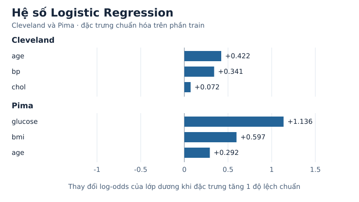

# T12 · Phân tích lỗi và hệ số Logistic Regression

Phân tích dùng đầu ra holdout của lượt khóa `t10-test-seed42`, với ngưỡng 0,5. Gaussian NB cho Cleveland và KNN cho Pima được chọn từ CV. Các ID tham chiếu dòng có `experiment=ablation`. [Metadata](../../results/t10-test-seed42/metadata.json) · [Metric](../../results/t10-test-seed42/metrics.csv) · [Dự đoán](../../results/t10-test-seed42/predictions.csv)

| Bộ dữ liệu | ML sai trên toàn bộ test | Luật bao phủ | Luật sai trong vùng bao phủ | ML và luật bất đồng trong vùng bao phủ |
|---|---:|---:|---:|---:|
| Cleveland | 28/61 (14 FP, 14 FN) | 27/61 (44,3%) | 12/27 (12 FP) | 6/27 |
| Pima | 49/154 (19 FP, 30 FN) | 50/154 (32,5%) | 18/50 (18 FP) | 28/50 |

| ID | Nhãn thật | ML | Luật | Gộp mới | Diễn giải |
|---|---:|---:|---:|---:|---|
| `cleveland:0015` | 0 | 1 (0,851) | — | 1 (0,851) | ML dương giả, luật bỏ ngỏ. |
| `cleveland:0013` | 1 | 0 (0,490) | 1 (0,550) | 1 (0,771) | Luật đổi âm giả thành dương đúng. |
| `cleveland:0006` | 0 | 0 (0,430) | 1 (0,550) | 1 (0,744) | Luật tạo dương giả từ ca ML phân loại đúng. |
| `pima:0016` | 1 | 0 (0,286) | — | 0 (0,286) | ML âm giả, luật bỏ ngỏ. |
| `pima:0027` | 1 | 0 (0,429) | 1 (0,775) | 1 (0,871) | Luật đổi âm giả thành dương đúng. |
| `pima:0077` | 0 | 0 (0,000) | 1 (0,775) | 1 (0,775) | Luật tạo dương giả từ ca ML phân loại đúng. |

Dấu “—” biểu thị luật bỏ ngỏ. Số trong ngoặc là điểm hỗ trợ đã làm tròn. Bảng lấy ID đầu tiên trong từng nhóm lỗi minh họa. Trên toàn holdout, gộp mới giảm FN từ 14 xuống 9 và tăng FP từ 14 lên 15 ở Cleveland. Ở Pima, FN giảm từ 30 xuống 14 và FP tăng từ 19 lên 31. Trong vùng bao phủ, các luật luôn dự đoán dương. Recall 1,0 ở vùng đó đi cùng 12 FP trên 12 ca âm Cleveland và 18 FP trên 18 ca âm Pima.

## Đối chứng cách gộp

- **Cleveland.** Hai cách gộp cho cùng điểm và nhãn trên cả 61 ca. Cấu hình có một luật đích nên hai công thức trùng nhau.
- **Pima.** Điểm khác ở 38/154 ca và số ca đổi nhãn bằng 0. Chênh lệch trung bình giữa điểm mới và điểm cũ là −0,01205 trên toàn holdout, với trị tuyệt đối lớn nhất 0,05510. Ở `pima:0027`, điểm cũ 0,927 và điểm mới 0,871 đều vượt ngưỡng. ROC-AUC toàn holdout của gộp cũ và gộp mới lần lượt là 0,78806 và 0,78843, phản ánh khác biệt thứ hạng dù nhãn giữ nguyên.

Các số đo mô tả một lần chia dữ liệu. Phân tích từng ca chỉ dựa trên nhãn và điểm đã xuất.

## Hệ số Logistic Regression

Hệ số lấy từ Logistic Regression fit lại trên toàn bộ phần train của từng bộ. Khi giữ cố định các đặc trưng khác, hệ số là mức thay đổi log-odds lớp dương khi đặc trưng tăng một độ lệch chuẩn của train. Với Pima, hệ số của `glucose` là +1,136, tương ứng odds lớp dương nhân khoảng 3,12 trong mô hình Logistic Regression. Các ca lỗi phía trên dùng Gaussian NB hoặc KNN. [Trạng thái mô hình T06](../../results/t06-cv-seed42/models.json)
